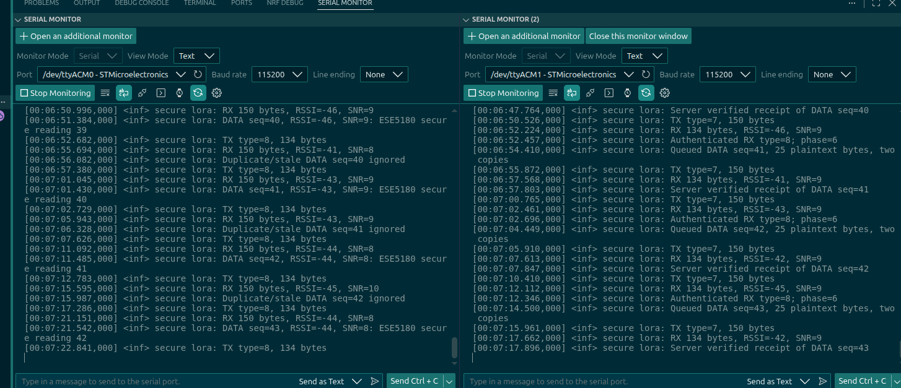
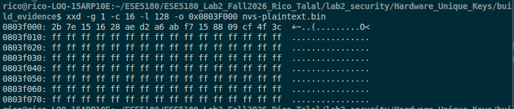
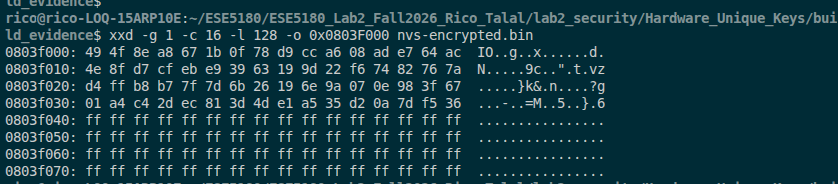

# Lab 2 IoT Security

ESE5180: IoT Wireless, Security, & Scaling

**Group Number:**

| Team Member Name | Email Address       |
|------------------|---------------------|
| Talal Ammache| tammache@seas.upenn.edu|
| Rico Zhuang         | zzhuan13@engineering.upenn.edu           |

**GitHub Repository URL:** https://github.com/Rico-Zhuang/ESE5180_Lab2_Fall2026_Rico_Talal

## Part 1 — Implementing Our Own LoRa Security

The [client](lab2_security/LoRa_Encrypted_Client_Zephyr/) and [server](lab2_security/LoRa_Encrypted_Server_Zephyr/) share the [protocol code](lab2_security/LoRa_Security_Common/). See [build and checkoff instructions](lab2_security/README.md).

Both firmwares passed hardware checks for pairing, encrypted delivery, duplicate rejection, receipts, and timeout recovery; all ten host test groups passed. The teaching-team checkoff is still required. Builds and private signing keys are excluded from Git.

### Answer 1.1

We chose Curve25519 Diffie–Hellman because the starter supports it and it creates fresh shared keys without transmitting a secret. Ed25519 signatures authenticate peers, and HKDF-SHA256 derives the AES key; this requires provisioning identities and a larger handshake.

AES provides confidentiality, while signatures and replay checks protect integrity. Retries and timeout recovery support availability during packet loss. Jamming, traffic analysis, and physical key extraction remain risks, and LoRa's range lets attackers operate farther away. Occasional lost readings may be acceptable for a noncritical sensor, but availability against jamming is not guaranteed.

## Part 2 — Encryption Speed and Memory Tradeoffs

All four [benchmark variants](lab2_security/AES_Benchmark_Zephyr/) ran on the same NUCLEO-WL55JC at 48 MHz, using 200 iterations and a 176-byte message. Each passed the known-answer and round-trip checks. [Saved measurements](lab2_security/AES_Benchmark_Zephyr/results/) were collected on October 26, 2026.

### Answer 2.1 — Speed

| Variant | Key setup, first call (cyc) | Key setup (cyc) | Encrypt (cyc/B) | Decrypt (cyc/B) | Encrypt 176 B (µs) |
| --- | ---: | ---: | ---: | ---: | ---: |
| SW, RAM tables | 46,319 | 8,815 | 82 | 82 | 301.628 |
| SW, ROM tables | 8,891 | 8,886 | 106 | 106 | 392.251 |
| SW, ROM + fewer | 8,902 | 8,882 | 107 | 107 | 395.003 |
| HW | 1,098 | 1,036 | 62 | 81 | 228.128 |

Cycle averages are rounded to integers; microseconds use the full accumulated cycle count.

### Answer 2.2 — Memory

| Variant | text | data | bss | Flash (text + data) | RAM (data + bss) |
| --- | ---: | ---: | ---: | ---: | ---: |
| SW, RAM tables | 30,704 | 220 | 19,028 | 30,924 | 19,248 |
| SW, ROM tables | 38,912 | 220 | 10,280 | 39,132 | 10,500 |
| SW, ROM + fewer | 32,808 | 220 | 10,280 | 33,028 | 10,500 |
| HW | 26,464 | 492 | 9,304 | 26,956 | 9,796 |

Values are bytes from `arm-zephyr-eabi-size`.

### Answer 2.3 — Locating the tables

| Variant | FT0 address | FT0 in RAM or flash | FT1 present | FSb address |
| --- | --- | --- | --- | --- |
| SW, RAM tables | `0x20002510` | RAM | yes | `0x20002c24` |
| SW, ROM tables | `0x080089f0` | flash | yes | `0x080096fd` |
| SW, ROM + fewer | `0x08007210` | flash | missing | `0x08007f25` |
| HW | missing | missing | missing | missing |

### Answer 2.4 — Choosing a variant

We would choose hardware AES: it used 9,796 bytes of RAM versus 19,248 for RAM tables. It also encrypted 176 bytes in 228.128 µs versus 301.628 µs. With encryption only once every ten minutes, saving scarce RAM matters more than the timing difference.

## Part 3 — Hardware Unique Keys

The [implementation and reproduction steps](lab2_security/Hardware_Unique_Keys/) use the starter sample key, as requested, instead of the unavailable Lab 1 key.

### Answer 3.1 — Plaintext storage

The 16-byte sample key is visible at `0x0803F000` in Board A's NVS dump.

### Answer 3.2 — Encrypted storage

HKDF-SHA256 derives an AES-128 key from the board UID and application salt. NVS stores the IV, CBC ciphertext, and a digest for checking decryption. Serial provisioning keeps the plaintext key out of the firmware; it was absent from the entire 256 KiB flash dump.

### Answer 3.3 — Cloning

Board A decrypted successfully. Board B rejected the identical 256 KiB flash image because its UID differs; both results persisted after reset. [Serial output and flash comparison](lab2_security/Hardware_Unique_Keys/results/clone-check.txt) record the test. Both boards remain ready for the teaching-team demonstration.

This demonstrates rejection of an exact clone. The UID is readable, so it is not a secret HUK; the CBC format also does not authenticate arbitrary record changes.
