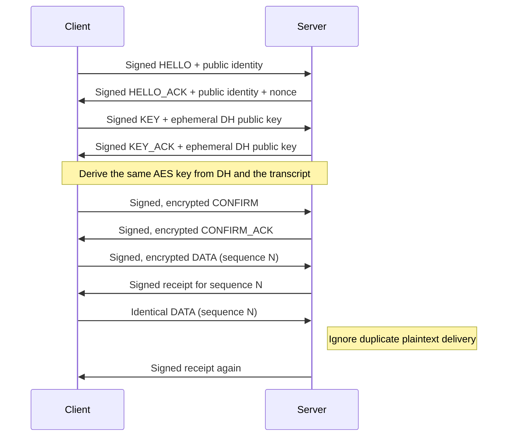

# Part 1 — Secure LoRa client and server

The client and server authenticate each other, exchange ephemeral Curve25519 keys, confirm an AES-128 session key, and then transfer signed, encrypted readings. Each reading is transmitted twice. The server prints the plaintext once and identifies the second copy as a duplicate.

The two `src/main.c` files select the board's role and locally generated identity. The state machine is in `LoRa_Security_Common/security_protocol.c`; the Zephyr radio and LED loop is in `LoRa_Security_Common/lora_app.c`. Both projects compile these same files so packet handling stays consistent. `sec_crypto.cpp` wraps the provided Arduino Crypto primitives and adds HKDF-SHA256.

## Build and run

From the root of the group repository, work from:

```bash
cd lab2_security
```

The `Crypto` sources are included alongside the two projects as regular files from [OperatorFoundation/Crypto](https://github.com/OperatorFoundation/Crypto), revision `4a6b190f7b1efd96d024d0f4510498963740b001`. Its original `LICENSE` and `LICENSE.txt` are preserved. A fresh checkout of this group repository includes the library without requiring submodules.

On a fresh checkout, generate identities **once per pair**, then build both roles:

```bash
# Requires the Python cryptography package; already available on this computer.
python3 tools/provision.py
python3 tools/lab2.py build client
python3 tools/lab2.py build server
```

The current local checkout already has the identities used by the flashed boards; skip `provision.py` here and run the two build commands. Private identity headers are excluded from Git, so a fresh checkout must generate its own pair. Do not regenerate them when switching boards. The generator refuses to overwrite them unless `--replace` is specified. Rotation requires rebuilding and reflashing **both** boards.

The helper uses the existing `~/ncs/v3.4.0` workspace, the installed Nordic toolchain environment, and `~/ESE5180/.deps/hal_stm32`. It builds separate `build-client` and `build-server` directories. Overrides are `LAB2_ZEPHYR_WORKSPACE`, `LAB2_TOOLCHAIN_BUNDLE`, and `LAB2_STM32_MODULE`. For another standard Zephyr installation, activate that environment, provide its workspace path, and ensure its STM32 HAL module is present.

List the serial devices and select the intended ST-LINK explicitly when flashing:

```bash
ls -l /dev/serial/by-id
python3 tools/lab2.py flash server --probe YOUR_SERVER_STLINK_SERIAL
python3 tools/lab2.py flash client --probe YOUR_CLIENT_STLINK_SERIAL
python3 -m serial.tools.miniterm /dev/ttyACM0 115200
```

The board assignments used in the hardware test are:

| Role | ST-LINK serial | Current console |
| --- | --- | --- |
| Server | `002C001B4142500220353451` | `/dev/ttyACM0` |
| Client | `0010000D4142500220353451` | `/dev/ttyACM1` |

Use the `/dev/serial/by-id` names to identify boards reliably; ACM numbers can change after reconnection. Radio settings match the starter: 433.92 MHz, SF10, 125 kHz bandwidth, coding rate 4/5, and a requested -15 dBm.

Blue means waiting for pairing, green means the key has been confirmed, and red lights during transmission. On both consoles, look for `PAIRED`. The server prints `DATA seq=1 ... ESE5180 secure reading 0` and then `Duplicate/stale DATA seq=1 ignored`. The client reports authenticated receipts. These messages were observed on both boards in the hardware test below.

## Trust and keys

`tools/provision.py` creates a random public 8-byte pair ID and two Ed25519 identities. Each board receives its own 32-byte private signing seed, its public key, and the other board's trusted public key. Both initial advertisement packets carry their public signing keys as the lab requires. The receiver checks that the advertised key matches its trusted peer key before accepting the signature. A self-signed advertisement from an arbitrary device is insufficient.

Private seeds are stored in each project's ignored `src/identity.h`, with owner-only file permissions. They are never transmitted or logged. These headers and build outputs stay out of Git. This group repository contains both projects, `LoRa_Security_Common`, the tools/tests, and the Crypto sources. The generated private seed remains embedded in its board's firmware; physical flash extraction is outside Part 1's protection.

Each handshake generates fresh random nonces and ephemeral DH keys. The ordered transcript includes the protocol label, pair ID, both nonces, both signing public keys, and both DH public keys. SHA256 hashes that transcript. HKDF-SHA256 uses this hash as its salt and the DH shared secret as its input; the expansion label is `ESE5180 LoRa AES128 v1`. Its first 16 output bytes become the AES key. The DH private keys and intermediate shared secret are cleared after derivation. The first 16 transcript-hash bytes identify the established session.

The lab's “long-term key” is the confirmed key for this session. It is kept in RAM and replaced after a timeout or reset; it is not a permanent key saved in flash.

## Packet definitions and handshake

All multi-byte integers are big endian. Every packet has this 38-byte header followed by its payload and a **64-byte Ed25519 signature over the entire header and payload**:

| Field | Bytes | Purpose |
| --- | ---: | --- |
| Magic `E518` | 4 | Identify this protocol |
| Version | 1 | Currently 1 |
| Type | 1 | Message type below |
| Source / destination | 1 each | Client = 1, server = 2 |
| Pair ID | 8 | Filter unrelated pairs |
| Session field | 16 | Client nonce during discovery/DH; transcript hash prefix afterward |
| Sequence | 4 | Zero for handshake; nonzero increasing number for data/receipts |
| Payload length | 2 | Checked against the received frame size |

| Order / type | Direction | Payload | Total bytes |
| --- | --- | --- | ---: |
| 1: HELLO | Client → server | Client signing public key (32) | 134 |
| 2: HELLO_ACK | Server → client | Server signing public key (32), server nonce (16) | 150 |
| 3: KEY | Client → server | Server nonce (16), client DH public key (32) | 150 |
| 4: KEY_ACK | Server → client | Server nonce (16), server DH public key (32) | 150 |
| 5: CONFIRM | Client → server | IV (16), CBC-encrypted client confirmation token with padding (48) | 166 |
| 6: CONFIRM_ACK | Server → client | IV (16), CBC-encrypted server confirmation token with padding (48) | 166 |
| 7: DATA | Client → server | IV (16), CBC-encrypted message with padding (16–128) | 134–246 |
| 8: RECEIPT | Server → client | SHA256 of the complete received DATA packet (32) | 134 |



Each confirmation token is SHA256 of the transcript hash followed by the sender's role byte. Its signature and decrypted value must both verify. The client cannot queue data before verifying `CONFIRM_ACK`; the server cannot accept data before verifying `CONFIRM`.

Encryption uses AES128 in CBC mode, built from the supplied AES block wrapper, with a fresh random IV and PKCS#7 padding. The receiver verifies the packet signature before decrypting or inspecting padding. Identical logical retries reuse the same signed ciphertext. The largest plaintext is 127 bytes: the radio limit is 255, the header/signature consume 102, and the IV plus whole-block ciphertext consume up to another 144.

The handout's guide question mentions a 32-byte signature, but the actual `SEC_SIG_LEN` is 64. A 32-byte Ed25519 **public key** is not the signature. This implementation and its payload calculations use the library's actual 64-byte signature.

## Loss, duplication, and recovery

Handshake frames are cached and retried until the peer advances. Retries are scheduled from the end of transmission, with different client/server intervals and random jitter. The server repeats its ACK even if no new request arrives. Repeated valid requests trigger the cached response without changing DH keys or moving backward through the states. A repeated final confirmation can regenerate the encrypted ACK after the server has entered the data phase.

The radio is configured for TX once before querying airtime, because this driver caches the airtime parameters only during TX configuration. It then switches back to RX.

Reception runs continuously with `lora_recv_async`. Its callback copies complete packets into a four-entry queue; the main loop polls that queue every 100 ms and performs signature verification outside the callback. The radio stays in RX throughout queue timeouts. It stops reception only when transmitting. This avoids cutting a long SF10 packet in half at a synchronous receive deadline, and lets the retry timer run without waiting through fixed receive windows. The second data copy is scheduled at least three seconds after the first finishes, leaving time for the receipt and signature processing.

After 60 seconds without an accepted peer message, either active endpoint clears its session and starts again. Invalid signatures, wrong IDs, wrong-session packets, and out-of-order handshake stages do not refresh that timer. Valid duplicates can refresh it, as allowed by NET-3. An already paired server ignores a new HELLO until its session times out, preventing a replayed advertisement from immediately replacing a working session. After one board reboots, recovery may therefore take about a minute.

Each data message gets a new sequence number and exactly two successful local radio transmissions. A 64-entry receive bitmap suppresses duplicates while permitting limited reordering; older packets outside the window are discarded. Session IDs reject data replayed from an earlier connection. Sequence numbers never wrap within a session.

Receipts identify exactly which signed ciphertext reached the server and provide peer-liveness feedback. They **do not** cancel the required second transmission or cause extra data retransmissions. This remains best-effort delivery: if both copies are lost, that reading is lost. The receiver can verify that accepted data is correct; delivery itself is not guaranteed. This implementation does not claim the optional TCP-like extra credit.

## Answer 1.1

We chose Curve25519 Diffie–Hellman because the starter supports it and it creates fresh shared keys without transmitting a secret. Ed25519 signatures authenticate peers, and HKDF-SHA256 derives the AES key; this requires provisioning identities and a larger handshake.

AES provides confidentiality, while signatures and replay checks protect integrity. Retries and timeout recovery support availability during packet loss. Jamming, traffic analysis, and physical key extraction remain risks, and LoRa's range lets attackers operate farther away. Occasional lost readings may be acceptable for a noncritical sensor, but availability against jamming is not guaranteed.

## Verification and checkoff

Run the host tests with:

```bash
python3 tests/run.py
```

They compile the actual shared C state machine and Arduino Crypto sources with AddressSanitizer and UndefinedBehaviorSanitizer. Only the random-source shim changes for Linux. Coverage includes an Ed25519 RFC test vector, independently checked HKDF output, all six handshake messages being lost/retried, duplicate handshake requests, two-copy delivery, ciphertext/header/signature tampering, untrusted identity substitution, invalid DH points, wrong confirmation tokens, exact one-minute resets, session replay, binary payload/padding boundaries, reordering, malformed lengths, and incorrect signed receipts.

A boot self-test also exercises the board's hardware-backed random source, its provisioned Ed25519 identity, Curve25519 shared-secret agreement, and AES encryption/decryption before networking starts.

Both board builds use Zephyr 4.4.0, SDK 1.0.1, west 1.5.0, and Python 3.12.4. Each current image uses approximately 61,448 bytes of flash and 17,816 bytes of RAM. Both build without compiler/Kconfig warnings, and all ten host test groups passed after the receive-loop update.

At checkoff, demonstrate:

1. Both boards print `PAIRED` after the six-message handshake.
2. Client readings appear on the server once despite two transmissions; duplicate messages are logged separately.
3. Explain each signed packet field, public-key trust, DH derivation, key confirmation, and replay protection.
4. Remove power from one board. Show the other logging the one-minute timeout; restore power and show a new handshake.
5. Explain that receipts confirm integrity/delivery of specific packets but do not make this a reliable stream.

Both boards were flashed with their assigned images and verified by OpenOCD. The two-board test on October 26, 2026 confirmed:

- Both boot crypto self-tests passed.
- All six handshake messages completed; the client logged `PAIRED` at 12.329 seconds after boot.
- Readings 0, 1, and 2 (sequence numbers 1, 2, and 3) were decrypted and printed exactly once each on the server.
- The second copy of all three readings was identified and ignored as a duplicate.
- The client verified signed receipts for all three readings.
- Observed successful-packet RSSI was about -39 to -35 dBm and SNR was 8–9 dB in this bench setup.

The recovery test used ST-LINK `reset halt` to make one peer unavailable without changing its firmware:

- With the server paused, the client repeated HELLO and restarted the handshake after 60.090 seconds measured from its start log.
- With the client paused after the server accepted HELLO, the server repeatedly sent HELLO_ACK and reset after 60.057 seconds measured from the last packet's arrival.
- After restarting the client, both boards paired again. The server decrypted sequence 1, ignored its duplicate, and the client verified its receipt. Both boards were left running their assigned firmware.

The first radio run exposed poor behavior with synchronous receive windows. Changing to continuous asynchronous reception and allowing more time before the duplicate transmission produced the passing run above.

Local evidence is in `build-hardware-test/baseline-client.log`, `baseline-server.log`, `baseline-result.json`, `recovery-client.log`, `recovery-server.log`, `recovery-result.json`, and `flash-client.log`/`flash-server.log`. These generated logs are ignored by Git. The teaching-team demonstration is still a separate required step.

## AI disclosure draft for 4.1

We used Codex to interpret the Part 1 requirements, check the local Zephyr installation, implement and document the protocol, and build/run software tests. Codex helped identify the need to trust the peer's public key before accepting signatures and to allow enough time to receive a full LoRa frame. Review this disclosure and add any later AI use before submission. Each partner still needs to understand and explain the firmware individually.

Algorithm references: [Curve25519 / RFC 7748](https://www.rfc-editor.org/rfc/rfc7748.html), [Ed25519 / RFC 8032](https://www.rfc-editor.org/rfc/rfc8032.html), and [HKDF / RFC 5869](https://www.rfc-editor.org/rfc/rfc5869.html).
